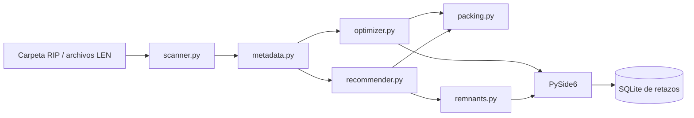

# Documentación Técnica - Optimizador CDI

## 1. Propósito

**Optimizador CDI** es una aplicación de escritorio para Windows que analiza separaciones RIP en archivos `.len` y propone acomodos rectangulares para planchas CDI y retazos físicos. El objetivo es aprovechar mejor la superficie disponible sin infringir restricciones de producción: límites del tambor, márgenes, pinza, tolerancia de corte, separación entre grabados, resolución DPI y tipo de fotopolímero.

La aplicación está escrita en Python con PySide6. Sus decisiones de acomodo usan heurísticas deterministas: producen propuestas reproducibles y de buena calidad, pero no buscan el óptimo matemático global de todas las combinaciones posibles.

## 2. Capacidades Principales

- Explora una carpeta RIP y detecta archivos `.len` sin distinguir mayúsculas de minúsculas.
- Extrae dimensiones y DPI desde metadatos XMP embebidos en los LEN.
- Agrupa los archivos por trabajo, tinta y tipo de fotopolímero.
- Calcula alternativas de acomodo para una plancha única y, cuando procede, una alternativa de dos placas.
- Sugiere subconjuntos de grabados compatibles por dimensiones, DPI y material.
- Gestiona inventario persistente de retazos y busca acomodos compatibles en ellos.
- Previsualiza resultados, permite seleccionar tintas desde el lienzo y mantiene historial de selección.
- Soporta cancelación, progreso, cachés y precálculo de sugerencias de baja prioridad.
- Registra errores técnicos en disco y se distribuye como ejecutable independiente para Windows.

## 3. Arquitectura



| Área | Archivos principales | Responsabilidad |
|---|---|---|
| Arranque | `main.py` | Inicializa Qt, rutas locales, registro de errores y la ventana principal. |
| Núcleo | `cdi_optimizer/core/` | Lectura LEN, compatibilidad, empaquetado, recomendaciones y retazos. |
| Interfaz | `cdi_optimizer/ui/` | Ventana, preferencias, lienzo, diálogos y estilos. |
| Persistencia | `remnants.py` + SQLite | Inventario de retazos y catálogo de materiales. |
| Pruebas | `tests/test_core.py` | Pruebas de metadatos, geometría, cachés, material, retazos y cancelación. |
| Compatibilidad | `core.py`, `ui.py` | Fachadas para imports históricos. |

## 4. Archivos LEN y Metadatos

### 4.1 Nomenclatura de trabajo, tinta y fotopolímero

La nomenclatura actual admitida es:

```text
<Papeleta>-<Trabajo>_FP45_<Tinta>.len
<Papeleta>-<Trabajo>_FP67_<Tinta>.len
<Papeleta>-<Trabajo>_FP112_<Tinta>.len
```

Ejemplo:

```text
64354-Ejemplo_FP67_K.len
```

El programa interpreta:

| Parte | Valor del ejemplo | Uso |
|---|---|---|
| Trabajo | `64354-Ejemplo` | Nodo de trabajo en el árbol RIP. |
| Fotopolímero | `FP67` | Categoría visual y restricción de compatibilidad. |
| Tinta | `K.len` | Archivo individual que se puede seleccionar y colocar. |

Los LEN históricos sin el sufijo `FP45`, `FP67` o `FP112` siguen siendo visibles y se agrupan bajo **Sin tipo de fotopolímero**. No deben mezclarse con archivos etiquetados al calcular un acomodo convencional.

### 4.2 Lectura de XMP

`metadata.py` busca bloques `<x:xmpmeta>...</x:xmpmeta>` en los primeros y últimos 256 KB del archivo. Extrae:

- `egGr:vsize`: alto en milímetros.
- `egGr:hsize`: ancho en milímetros.
- `egGr:vresolution`: DPI vertical, cuando existe.
- `egGr:hresolution`: DPI horizontal, cuando existe.

Solo se acepta una medida positiva y finita. Si el XMP está incompleto, separado entre regiones, no contiene ambos tamaños o el archivo no se puede abrir, el LEN se omite y se informa el error.

La lectura se guarda en una caché LRU de hasta 2048 entradas. La clave incluye ruta normalizada, tamaño, fecha de modificación y fecha de cambio del archivo; al modificar un LEN, su resultado se vuelve a leer automáticamente.

## 5. Reglas de Compatibilidad

### 5.1 Resolución DPI

Un acomodo convencional solo combina varias tintas cuando todas comparten exactamente el mismo par de DPI y la resolución es verificable. Una tinta única puede procesarse aunque no tenga DPI disponible.

Las sugerencias separan internamente los grupos por resolución. Por tanto, pueden analizar toda la carpeta, pero ninguna propuesta reúne DPI distintos.

### 5.2 Fotopolímero

Las operaciones convencionales de acomodo requieren un único tipo de fotopolímero: no pueden mezclarse `FP45`, `FP67`, `FP112` ni archivos etiquetados con archivos sin tipo.

Las sugerencias, tanto normales como en retazos, agrupan internamente por la pareja:

```text
(resolución DPI, tipo de fotopolímero)
```

Esto permite analizar todos los LEN disponibles y devolver propuestas independientes para cada tipo compatible sin mezclar materiales.

### 5.3 Material de retazo

El inventario permite nombres descriptivos de material, por ejemplo:

```text
67 HUAHUANG
112 HUAHUANG
67 Marca alternativa
```

Para un LEN `FP67`, el programa busca el código delimitado `67` en el nombre del material del retazo. Así, `FP67` es compatible con `67 HUAHUANG` y `HUAHUANG 67`, sin exigir que el nombre completo sea exactamente `FP67`.

Los retazos cuyo nombre no contiene un código admitido no se asignan automáticamente a LEN etiquetados. Los LEN sin tipo verificable no permiten inferir el sustrato: el operador debe confirmar el material antes del corte.

## 6. Configuración de Producción

Las preferencias se guardan mediante `QSettings` bajo la organización `MTRemozar` y la aplicación `OptimizadorCDI`.

| Parámetro | Valor inicial | Efecto |
|---|---:|---|
| Tolerancia de corte | 3 mm | Reserva fija añadida al borde útil de cada plancha o retazo. |
| Ratio máximo | 3:1 | Limita la relación entre el lado largo y corto de una placa. Intervalo permitido: 1:1 a 10:1. |
| Tambor CDI | 1067 x 1270 mm | Límites máximos de la plancha normal. |
| Márgenes superior, izquierdo y derecho | 7 mm | Zona no utilizable por lado. |
| Pinza | 25 mm | Reserva de pinza aplicada en el lado corto de la placa. |
| Separación por lado | 3 mm | Distancia de seguridad alrededor de cada grabado. |
| Giro | Activado | Permite girar cada grabado 90 grados cuando es viable. |
| Tamaños cercanos | Desactivado | Permite generar candidatos con diferencias de 1, 2 o 3 mm por dimensión; las medidas reales se conservan. |
| Precálculo | Desactivado | Ejecuta sugerencias en segundo plano tras un periodo de inactividad. |
| Inactividad | 5 min | Intervalo del precálculo; configurable entre 1 y 120 minutos. |
| Historial de selección | 25 cambios | Profundidad de deshacer y rehacer. |

La separación se aplica como margen por los cuatro lados de cada grabado. Por ello, con una separación configurada de $s$, el rectángulo usado para empaquetar mide $w + 2s$ por $h + 2s$, y dos artes adyacentes quedan separadas $2s$.

## 7. Algoritmo de Empaquetado

### 7.1 Modelo geométrico

Cada tinta se modela como un rectángulo de ancho y alto extraídos del LEN. Se añaden márgenes de separación para el empaquetado, se colocan las piezas y finalmente se restituye el tamaño real de cada arte para visualizarla.

El motor verifica que:

- Ningún grabado se superponga a otro.
- Todas las piezas queden dentro del rectángulo útil.
- Se respeten márgenes, pinza, tolerancia y separación.
- La proporción de la placa no exceda el ratio máximo.
- Si hay pinza, la placa se mantenga en orientación de retrato: ancho no mayor que alto.

### 7.2 MaxRects con descomposición de espacios libres

El núcleo usa una variante heurística de **MaxRects**:

1. Se inicia con un único rectángulo libre que representa el área disponible.
2. Para cada tinta, se evalúan los rectángulos libres y las orientaciones permitidas.
3. Se selecciona la posición con menor puntuación geométrica.
4. El rectángulo ocupado divide los espacios libres afectados.
5. Los espacios contenidos en otros se eliminan para reducir el conjunto de candidatos.

La puntuación prioriza, en este orden:

1. Menor envolvente utilizada.
2. Proximidad al ratio objetivo del perfil.
3. Menor residuo del rectángulo libre.
4. Posición estable dentro del espacio disponible.
5. Preferencia determinista para romper empates.

El resultado se compacta después hacia abajo y a la izquierda. Esta compactación elimina huecos desplazando cada grabado sin modificar su tamaño ni producir solapamientos.

### 7.3 Búsqueda de ancho y ordenaciones

El algoritmo no prueba todos los anchos posibles. Construye un conjunto acotado de anchos candidatos mediante:

- Ancho mínimo que admite la pieza más exigente.
- Ancho máximo disponible.
- Cinco fracciones intermedias del intervalo.
- Anchos de las piezas y múltiplos útiles para tamaños repetidos.

Para cada ancho prueba varias ordenaciones de entrada:

- Área descendente.
- Lado largo descendente.
- Lado corto descendente.
- Ancho descendente.
- Alto descendente.
- Dimensiones, cuando el perfil prioriza agrupación dimensional.

Cuando todas las piezas son idénticas, además evalúa distribuciones explícitas en cuadrícula. Esto mejora la calidad en lotes repetitivos y evita depender solo de la heurística general.

### 7.4 Giro individual y línea base

Si el giro está activado, cada pieza no cuadrada se prueba en su orientación normal y en 90 grados. El motor compara la propuesta con giro contra una línea base sin giro y conserva la alternativa sin giro si la girada empeora el área compactada sin separación. Así, habilitar el giro no reduce el aprovechamiento de referencia.

### 7.5 Eficiencia

La eficiencia se calcula usando el área original de los grabados frente a la envolvente compactada del arte, sin contar el espacio de seguridad entre piezas como área aprovechada. Los márgenes, la pinza y la tolerancia también quedan fuera del área aprovechable de la plancha.

La eficiencia exacta se conserva internamente para ordenar; la interfaz muestra el porcentaje redondeado.

## 8. Alternativas de Acomodo Normal

### 8.1 Perfiles iniciales

Al calcular un acomodo, `optimizer.py` genera hasta cuatro perfiles iniciales:

| Perfil | Objetivo |
|---|---|
| Máximo aprovechamiento | Minimiza área con tolerancia de aspecto mínima. |
| Equilibrado | Busca una proporción próxima a 1.5:1. |
| Seguro para tambor | Permite usar el ratio máximo configurado. |
| Agrupado por dimensiones | Favorece mantener tamaños similares juntos. |

Se eliminan propuestas geométricamente equivalentes usando una firma de tipo, dimensiones, placas y posiciones. La interfaz muestra como máximo diez alternativas.

### 8.2 Paralelismo

Si hay 16 o más piezas, al menos dos perfiles y más de un núcleo disponible, los perfiles iniciales se evalúan en procesos separados. El máximo es cuatro procesos. En lotes menores, y si el paralelismo falla, se procesa en serie para conservar compatibilidad y permitir cancelación.

### 8.3 Variantes adicionales

El botón de buscar más variantes prueba perfiles adicionales de proporción y giro. Cada intento añade como máximo dos geometrías nuevas y no supera diez opciones visibles. Estas variantes se calculan de una en una para limitar el coste y conservar una respuesta predecible.

### 8.4 Dos placas

Cuando hay más de una tinta, el motor también puede evaluar una alternativa de dos placas independientes unidas por el lado vertical y alineadas por la base. Agrupa tamaños idénticos y considera particiones de esos grupos; con pocos grupos prueba más combinaciones y con muchos usa estrategias acotadas.

La alternativa solo se conserva si respeta límites, ratio y pinza de ambas placas, y si su eficiencia interior no queda significativamente por debajo de la opción de una placa.

## 9. Sugerencias de Combinaciones

### 9.1 Objetivo

Las sugerencias no intentan evaluar todos los subconjuntos de archivos, porque el número de combinaciones crece de forma exponencial. En su lugar, generan una colección acotada de candidatos prometedores y empaquetan cada uno con varios perfiles.

### 9.2 Generación de candidatos

Dentro de cada grupo compatible de DPI y fotopolímero, el recomendador:

1. Recorre las piezas con cinco criterios de ordenación.
2. Forma subconjuntos incrementales mientras sigan cabiendo.
3. Conserva candidatos por cantidad y firma de dimensiones.
4. Añade grupos completos de dimensiones iguales.
5. Añade combinaciones de dos grupos dimensionales.
6. Opcionalmente añade grupos de tamaños cercanos dentro de la tolerancia configurada.
7. Conserva el conjunto completo como candidato cuando es viable.

El número de candidatos retenidos por cantidad disminuye con el tamaño del grupo:

| Tamaño del grupo | Límite por cantidad |
|---:|---:|
| 1 a 128 tintas | 16 |
| 129 a 256 tintas | 9 |
| Más de 256 tintas | 3 |

### 9.3 Evaluación y ranking

Cada candidato se empaqueta con cuatro perfiles. Las propuestas se ordenan por:

1. Eficiencia exacta descendente.
2. Menor cantidad de grupos dimensionales.
3. Mayor tamaño del grupo dimensional principal.

Se guardan hasta tres variantes por cantidad y se eliminan firmas de dimensiones y geometrías repetidas. La pantalla de sugerencias indica resolución, fotopolímero, coincidencias exactas y, si se activó, coincidencias por tolerancia.

### 9.4 Caché y precálculo

Las sugerencias normales se almacenan durante la sesión usando una clave que incluye rutas, tamaño y fechas de archivo, además de los parámetros de cálculo. Se retienen los últimos cuatro conjuntos.

El precálculo se ejecuta con prioridad baja después de la inactividad configurada. Se cancela ante actividad del usuario; solo los resultados completos se guardan en la caché.

## 10. Inventario y Acomodos en Retazos

### 10.1 Persistencia

El inventario se guarda en una base SQLite local:

```text
%LOCALAPPDATA%/MTRemozar/OptimizadorCDI/retazos.sqlite
```

Cada retazo tiene identificador, ancho físico, alto físico, material, ubicación, notas y fecha de creación. El catálogo de materiales evita duplicados sin distinguir mayúsculas de minúsculas.

La importación CSV requiere `ancho_mm`, `alto_mm` y `material`; admite `ubicacion` y `notas`. Valida todo el archivo antes de insertar, de modo que un error cancela la importación completa.

### 10.2 Búsqueda directa en retazos

**Buscar acomodo en retazos** usa exclusivamente las tintas marcadas en el árbol RIP. Es la opción adecuada cuando el operador ya conoce el conjunto exacto que desea grabar; requiere al menos una tinta seleccionada. Agrupa esa selección por DPI y fotopolímero; para cada grupo prueba únicamente los retazos cuyo código de material sea compatible.

Para cada retazo, el motor:

1. Ordena sus lados para dejar la pinza en el lado corto.
2. Calcula el área útil después de márgenes, pinza y tolerancia.
3. Ejecuta el empaquetado con las dimensiones físicas del retazo como límite.
4. Reubica el resultado compacto sobre el retazo físico.
5. Calcula el aprovechamiento como área total de grabados entre el área útil completa del retazo.

Para cada geometría de retazo se prueban los cuatro perfiles del recomendador: compacto, equilibrado, ratio máximo y agrupado por dimensiones. Se conserva el acomodo con mayor eficiencia interna y, en empate, menor área de placa. Esto multiplica como máximo por cuatro el trabajo geométrico de una búsqueda directa, pero reduce los casos en los que un acomodo viable no se encuentra por depender de un único perfil. Las geometrías iguales, incluidas las que no admiten el conjunto seleccionado, se reutilizan desde caché durante la misma búsqueda.

### 10.3 Sugerencias en retazos

**Sugerir combinaciones en retazos** también usa toda la carpeta RIP. Genera subconjuntos con el recomendador normal y los prueba contra cada retazo compatible.

Para cada combinación de retazo, DPI y fotopolímero conserva la mejor propuesta según eficiencia exacta y cantidad de grabados. Permite tintas individuales, a diferencia de las sugerencias normales. Muestra resultados parciales durante la búsqueda y respeta un límite de tiempo:

```text
min(600 segundos, 2 x última duración de sugerencias normales)
```

El valor inicial es 120 segundos si aún no existe una medición. Los resultados detenidos o agotados por tiempo no se guardan como caché completa.

### 10.4 Consumo de retazos

Desde la vista de retazo, **Marcar usado...** ofrece dos acciones:

- Eliminar el retazo del inventario.
- Actualizar solo sus dimensiones restantes, conservando material, ubicación y notas.

## 11. Interfaz y Operación

### 11.1 Árbol RIP

El árbol se organiza verticalmente por `FP45`, `FP67`, `FP112` y archivos sin tipo. Debajo aparecen los trabajos y, como último nivel, las tintas. El estado de cada trabajo se actualiza automáticamente al marcar o desmarcar sus tintas.

Funciones disponibles:

- Búsqueda por trabajo o tinta.
- Seleccionar visibles y limpiar.
- Doble clic para marcar un trabajo.
- Deshacer y rehacer selección con `Ctrl+Z` y `Ctrl+Y`.
- Tooltip con dimensiones y DPI de cada tinta.
- Clic en una pieza del lienzo para localizar su tinta en el árbol.

### 11.2 Lienzo y resultados

El lienzo representa planchas, áreas útiles, pinza, márgenes, grabados, giro y unión de placas. Los resultados muestran dimensiones, número de grabados, placas y eficiencia.

La vista de retazo conserva el acomodo normal anterior mientras se muestra. Al salir, restaura la visualización previa.

### 11.3 Supervisión de carpeta y trabajos en segundo plano

La carpeta RIP se vigila con `QFileSystemWatcher`. Si se eliminan archivos, el árbol se actualiza y las selecciones inexistentes se eliminan.

Los cálculos se ejecutan en tareas Qt. Se pueden cancelar desde la interfaz; al cerrar la aplicación durante un cálculo, se solicita cancelación antes de liberar recursos.

## 12. Errores, Registro y Límites

### 12.1 Registro

Los errores técnicos se registran en:

```text
%LOCALAPPDATA%/MTRemozar/OptimizadorCDI/logs/optimizador.log
```

El registro rota al alcanzar 2 MB y conserva tres copias de respaldo. Si la carpeta no puede crearse, la aplicación mantiene un manejador nulo para no bloquear el funcionamiento.

### 12.2 Límites importantes

- El acomodo es heurístico; no garantiza el óptimo global.
- Los LEN se modelan como rectángulos; no se interpretan contornos, sangrados especiales ni restricciones físicas no almacenadas en el XMP.
- Los archivos sin tipo de fotopolímero requieren comprobación manual de material.
- La coincidencia automática de retazo depende de que el nombre contenga `45`, `67` o `112` como código delimitado.
- El inventario no descuenta sobrantes automáticamente: el operador debe elegir actualizar o eliminar al marcar el retazo usado.
- Los resultados siempre deben validarse físicamente antes de cortar o grabar.

## 13. Pruebas

La suite usa `unittest` y cubre, entre otros temas:

- Lectura y caché de XMP.
- Resolución DPI y fotopolímero.
- Geometría, giro, ratio, compactación y separación.
- Determinismo de la heurística.
- Perfiles paralelos frente a perfiles secuenciales.
- Sugerencias y límites de candidatos.
- Inventario, CSV, retazos, cancelación y cachés.
- Compatibilidad de códigos como `FP67` con materiales como `67 HUAHUANG`.

Ejecutar:

```powershell
python -m unittest discover -s tests -v
```

La suite evoluciona con el proyecto; ejecuta el comando anterior para obtener el total vigente.

## 14. Instalación y Empaquetado

### 14.1 Desarrollo

Requiere Python 3.10 o posterior.

```powershell
python -m venv .venv
.\.venv\Scripts\Activate.ps1
python -m pip install -r requirements.txt
python main.py
```

Dependencia principal:

```text
PySide6 >= 6.6, < 7
```

### 14.2 Ejecutable de Windows

```powershell
python -m pip install -r requirements-build.txt
python -m PyInstaller --noconfirm --clean --windowed --onefile --name OptimizadorCDI-final-v41 --icon app.ico --add-data "logo.png;." --add-data "app.ico;." main.py
```

El resultado es:

```text
dist/OptimizadorCDI-final-v41.exe
```

El ejecutable se puede copiar a otros equipos Windows sin instalar Python. Cada equipo conserva por separado la ruta RIP, preferencias e inventario local.

## 15. Guía de Diagnóstico Rápido

| Síntoma | Comprobación recomendada |
|---|---|
| No se ven LEN | Verificar la ruta RIP y que los archivos terminen en `.len`. |
| LEN omitido | Revisar que contenga un bloque XMP con `vsize` y `hsize` positivos. |
| No se puede combinar una selección | Revisar que todas las tintas tengan el mismo DPI y tipo de fotopolímero. |
| No hay retazos compatibles | Confirmar que el nombre del material tenga el código `45`, `67` o `112` correspondiente. |
| No aparece un acomodo | Revisar dimensiones de tambor o retazo, márgenes, pinza, tolerancia, separación y ratio máximo. |
| Sugerencias lentas | Reducir archivos disponibles, esperar al precálculo o revisar el límite de tiempo de retazos. |
| Error técnico | Consultar `optimizador.log` en la carpeta local de la aplicación. |

## 16. Principios de Evolución

Para conservar resultados confiables al modificar algoritmos:

1. Añadir un caso reproducible a la suite antes de cambiar el comportamiento.
2. Comparar eficiencia, dimensiones y tiempo contra un conjunto de referencia real anonimizado.
3. Mantener el mismo resultado cuando la nueva estrategia no mejore una métrica acordada.
4. Limitar cualquier búsqueda adicional con presupuesto de tiempo y cancelación.
5. Evitar cambios de algoritmo junto con cambios de interfaz en la misma iteración cuando sea posible.
